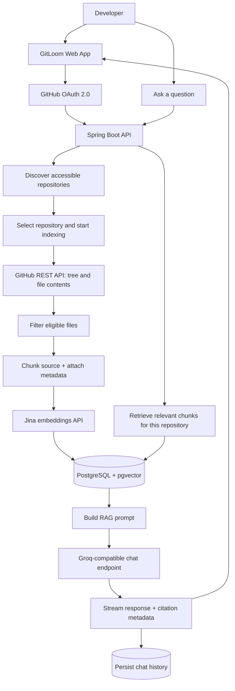

# GitLoom

<p align="center">
  <strong>Turn a GitHub repository into a searchable, conversational codebase.</strong>
  <br />
  Understand unfamiliar projects faster with AI answers grounded in repository code.
  <br /><br />
  <a href="https://gitloom.netlify.app/"><strong>🚀 Open the Live App</strong></a>
  &nbsp;·&nbsp;
  <a href="https://github.com/Flying-vipul/GitLoom"><strong>Source Code</strong></a>
</p>

<p align="center">
  
  
  
  
  
</p>

---

## What is GitLoom?

**GitLoom is an AI-powered codebase assistant that lets developers ask questions about a GitHub repository and receive answers grounded in that repository's source code.** Instead of manually navigating dozens of files to understand an unfamiliar project, connect your GitHub account, index a repository, and ask questions in natural language.

GitLoom uses retrieval-augmented generation (RAG). It filters supported repository files, splits their contents into smaller chunks, creates vector embeddings, and stores those vectors in PostgreSQL with pgvector. When a question arrives, GitLoom retrieves relevant chunks from the selected repository and provides them to the configured chat model as context. Responses can include source-file citation metadata to help you trace answers back to the code.

**Live application:** [https://gitloom.netlify.app/](https://gitloom.netlify.app/)

## Why GitLoom?

Understanding a codebase takes more than reading isolated files. GitLoom is designed to make that exploration more direct:

- **Ask in natural language:** Explore implementation details and how parts of a project work without manually searching every file.
- **Code-grounded responses:** Retrieve relevant source chunks before generating an answer.
- **Source traceability:** Return citation metadata associated with retrieved files.
- **Repository-aware indexing:** Index supported source and documentation files while skipping common build outputs and dependency folders.
- **Streaming answers:** Receive generated text progressively through Server-Sent Events (SSE).
- **Persistent chat history:** Store chat sessions and messages for later reference.
- **GitHub OAuth:** Sign in through GitHub and work with repositories available to your account.
- **Indexing progress:** Track indexing state, processed files, and chunk counts.

## How it works



### Request lifecycle

1. **Sign in:** The user authenticates with GitHub OAuth. The backend maintains an authenticated session.
2. **Choose a repository:** GitLoom fetches repositories the signed-in user can access and stores repository metadata.
3. **Index the source:** An asynchronous task reads the repository's default branch tree, filters eligible files, fetches their contents, splits them into chunks, and creates embeddings in batches.
4. **Store searchable context:** Embeddings and metadata—including repository ID, file path, language, and chunk index—are stored using the pgvector vector-store integration.
5. **Ask a question:** GitLoom performs similarity search scoped to the selected repository and builds a prompt from the retrieved code context and the user's question.
6. **Stream the response:** The configured chat model generates an answer that the backend streams over SSE. The assistant message and citation metadata are persisted.

## Features

### GitHub integration and authentication

- GitHub OAuth sign-in with Spring Security.
- Repository listing and synchronization through the GitHub REST API.
- Access to repositories available to the authenticated account, subject to GitHub permissions and the OAuth scopes granted.
- Ownership checks in repository and chat operations.
- GitHub access tokens encrypted before being stored by the backend.

### Code indexing

- Asynchronous indexing using a dedicated Spring task executor.
- Progress tracking for total files, processed files, chunks, and indexing status.
- Configurable file-size limits and chunking settings.
- Skips common generated/dependency folders such as `node_modules`, `.git`, `dist`, `build`, `target`, `.next`, `vendor`, and IDE folders.
- Supports common languages and file formats including Java, Kotlin, JavaScript, TypeScript, Python, Go, Rust, C/C++, C#, PHP, Ruby, Swift, HTML, CSS, Markdown, YAML, shell scripts, Dockerfiles, and properties files.
- Batches vector inserts to reduce per-write overhead.
- Re-indexing attempts to remove stored vectors for the selected repository before rebuilding its index.

### RAG-powered code chat

- Semantic retrieval using pgvector similarity search.
- Retrieval scoped to the active repository so chunks from other repositories are not mixed into the same retrieval results.
- Prompt instructions direct the model to answer from provided code context and acknowledge when the context is insufficient.
- Progressive response delivery using Server-Sent Events.
- Citation metadata can include source path, language, and optional line range fields.
- Persistent chat sessions and ordered message history per repository.

### Backend foundations

- REST API built with Spring Boot.
- Separation of controllers, services, repositories, DTOs, and AI/indexing components.
- Centralized exception handling and configurable CORS origins.
- PostgreSQL persistence with Spring Data JPA / Hibernate.
- Flyway dependency and migration configuration.
- Multi-stage Docker build using Java 21 and a non-root runtime user.
- Docker Compose service for local PostgreSQL with pgvector.

## Technology stack

| Layer | Technology | Role |
|---|---|---|
| Language | Java 21 | Application and business logic |
| Backend framework | Spring Boot 4.1.1 | REST API and application runtime |
| Security | Spring Security + OAuth2 Client | GitHub sign-in and protected API routes |
| AI orchestration | Spring AI | Chat integration, document splitting, vector-store abstraction |
| Chat model provider | Groq API via an OpenAI-compatible endpoint | Generates code-chat responses |
| Embeddings | Jina AI `jina-embeddings-v5-omni-small` | Converts code chunks into vectors |
| Database | PostgreSQL | Users, repositories, sessions, and messages |
| Vector search | pgvector | Embedding storage and similarity search |
| ORM | Spring Data JPA / Hibernate | Relational persistence |
| Database tooling | Flyway | Migration support/configuration |
| GitHub integration | GitHub REST API | Repository discovery and source retrieval |
| Streaming | Server-Sent Events (SSE) | Progressive response delivery |
| Containerization | Docker + Docker Compose | Backend image and local vector database |
| Frontend deployment | Netlify | Hosts the live web app |

## Repository structure

```text
GitLoom/
├── backend/
│   ├── src/main/java/devPilot/backend/
│   │   ├── DTO/                 # API request and response objects
│   │   ├── config/              # Security, CORS, encryption and application config
│   │   ├── controllers/         # Auth, repository, chat and health endpoints
│   │   ├── exceptions/          # API exceptions and global handler
│   │   ├── model/               # User, repository, chat session and message entities
│   │   ├── repository/          # Spring Data repositories
│   │   ├── security/            # Current user and GitHub OAuth integration
│   │   └── services/
│   │       ├── AI/              # Retrieval, prompts, citations and streaming
│   │       ├── github/          # GitHub API client and request pacing
│   │       └── indexing/        # File filtering, chunking and indexing pipeline
│   ├── src/main/resources/
│   │   └── application.properties.example
│   ├── src/test/                # Backend tests
│   ├── docker/postgres/         # PostgreSQL extension initialization
│   ├── Dockerfile
│   ├── docker-compose.yml
│   └── pom.xml
└── README.md
```

> The current GitHub repository contains the backend source and its container/database configuration. The frontend source is not present in this repository; the deployed web application is linked above.

## Getting started locally

### Prerequisites

- Java 21
- Docker Desktop with Docker Compose
- Git
- A GitHub OAuth App
- API credentials for Groq and Jina AI

### 1. Clone the repository

```bash
git clone https://github.com/Flying-vipul/GitLoom.git
cd GitLoom/backend
```

### 2. Start PostgreSQL with pgvector

The Compose file maps PostgreSQL to host port `5434`:

```bash
docker compose up -d postgres
```

The local Compose defaults are:

| Setting | Value |
|---|---|
| Database | `devpilot` |
| Username | `postgres` |
| Password | `postgres` |
| Host port | `5434` |

These defaults are for local development only. Do not use them for an internet-facing or production database.

### 3. Configure application properties

Copy the example configuration to `application.properties`.

**macOS / Linux**

```bash
cp src/main/resources/application.properties.example src/main/resources/application.properties
```

**Windows PowerShell**

```powershell
Copy-Item src/main/resources/application.properties.example src/main/resources/application.properties
```

Set the following environment variables before starting the backend:

| Variable | Purpose |
|---|---|
| `DB_URL` | PostgreSQL JDBC URL, e.g. `jdbc:postgresql://localhost:5434/devpilot` |
| `DB_USERNAME` | Database username |
| `DB_PASSWORD` | Database password |
| `GITHUB_CLIENT_ID` | GitHub OAuth App client ID |
| `GITHUB_CLIENT_SECRET` | GitHub OAuth App client secret |
| `GROQ_API_KEY` | Key used by the configured Groq-compatible chat endpoint |
| `JINA_API_KEY` | API key for Jina embeddings |
| `FRONTEND_URL` | Frontend origin, e.g. `http://localhost:5173` |
| `CORS_ALLOWED_ORIGINS` | Comma-separated frontend origins allowed by CORS |
| `TOKEN_ENCRYPTOR_PASSWORD` | Secret used to encrypt stored GitHub access tokens |
| `TOKEN_ENCRYPTOR_SALT` | Hex-encoded salt used by the token encryptor |

**Security notes**

- Generate your own credentials and secrets. Never commit real API keys or OAuth secrets.
- Use a strong, unique token-encryption password and a valid salt; keep them stable between restarts because they are needed to decrypt stored tokens.
- The example includes a development-only fallback for some settings. Override it for local shared environments and production.
- Grant only the GitHub permissions needed for the repositories you want to use.
- Keep production credentials in environment settings or a secret manager, not in source control.

### 4. Configure GitHub OAuth

Create a GitHub OAuth App in GitHub Developer Settings. For local development, set its authorization callback URL to:

```text
http://localhost:8080/login/oauth2/code/github
```

Ensure `FRONTEND_URL` and `CORS_ALLOWED_ORIGINS` match the actual frontend origin. For production, update the OAuth callback URL to the deployed backend's corresponding `/login/oauth2/code/github` endpoint.

### 5. Run the backend

From the `backend/` directory:

```bash
./mvnw spring-boot:run
```

On Windows PowerShell:

```powershell
.\mvnw.cmd spring-boot:run
```

The API uses port `8080` unless the server port is overridden.

Check the health endpoint:

```bash
curl http://localhost:8080/api/health
```

Expected response:

```text
UP
```

### 6. Build or containerize the backend

Build the JAR:

```bash
./mvnw clean package
```

Build a Docker image from the `backend/` directory:

```bash
docker build -t gitloom-backend .
```

Provide the required environment variables and production configuration when running or deploying the image.

## Configuration reference

The example configuration is maintained in `backend/src/main/resources/application.properties.example`.

| Setting | Default | Notes |
|---|---|---|
| `app.indexing.max-file-bytes` | `102400` | Maximum eligible file size (100 KiB) |
| `app.indexing.chunk-size` | `800` | Chunk-size setting used by the code chunker |
| `app.github.api-delay-ms` | `50` | Delay applied between file indexing requests |
| `spring.ai.vectorstore.pgvector.dimensions` | `1024` | Must match the embedding model output dimensions |
| `spring.ai.vectorstore.pgvector.index-type` | `HNSW` | pgvector index type |
| `spring.ai.vectorstore.pgvector.distance-type` | `COSINE_DISTANCE` | Vector distance metric |
| `server.servlet.session.timeout` | `7d` | Server-side session timeout |
| `server.servlet.session.cookie.name` | `DEVPILOT_SESSION` | Session cookie name |

## API overview

The backend exposes these main endpoint groups. Protected API routes require an authenticated session.

| Method | Endpoint | Purpose |
|---|---|---|
| `GET` | `/api/health` | Basic health check |
| `GET` | `/api/auth/login-url` | Returns the GitHub OAuth login path |
| `GET` | `/api/auth/me` | Returns the authenticated user's profile |
| `GET` | `/api/repos` | Lists/synchronizes accessible repositories; `?refresh=false` uses stored results |
| `GET` | `/api/repos/{id}` | Gets a repository owned by the current user |
| `GET` | `/api/repos/{id}/status` | Gets indexing status and progress |
| `POST` | `/api/repos/{id}/index` | Starts asynchronous indexing |
| `POST` | `/api/repos/{id}/index/cancel` | Requests indexing cancellation |
| `POST` | `/api/chat/sessions` | Creates a chat session for an indexed repository |
| `GET` | `/api/chat/sessions?repositoryId={id}` | Lists chat sessions for a repository |
| `GET` | `/api/chat/sessions/{sessionId}/messages` | Retrieves chat history |
| `POST` | `/api/chat/sessions/{sessionId}/stream` | Submits a question and streams the response using SSE |

For exact request/response structures, see the controller and DTO classes in `backend/src/main/java/devPilot/backend/`.

## Deployment notes

- **Frontend:** [GitLoom on Netlify](https://gitloom.netlify.app/)
- **Backend:** Deploy the Spring Boot application as a Java 21 service or container and configure its secrets in the hosting platform.
- **Database:** Use PostgreSQL with pgvector enabled. The vector dimensions must match the selected embedding model.
- **GitHub OAuth:** Configure the deployed backend's OAuth callback and set `FRONTEND_URL` and `CORS_ALLOWED_ORIGINS` to the deployed frontend origin.
- **Streaming:** Configure any reverse proxy so it does not buffer the chat SSE endpoint.
- **Secrets:** Never commit API keys, OAuth secrets, database passwords, or token-encryption material.

The frontend is deployed at the URL above. Full functionality depends on the backend, database, GitHub OAuth configuration, and provider credentials being available and correctly configured.

## Current scope and limitations

- Indexing is limited to supported file types and the configured maximum file size.
- The current indexing pipeline reads the repository's default branch.
- Model responses depend on retrieved context and provider behavior. Review citations and source code when accuracy matters.
- GitHub API rate limits, repository access permissions, provider quotas, and network availability can affect indexing and chat.
- The included Docker Compose file starts PostgreSQL with pgvector; it does not orchestrate the entire frontend/backend stack.
- Flyway is configured as a dependency, but verify that the required migration scripts exist and are up to date for your deployment.

## Contributing

Contributions, bug reports, and suggestions are welcome.

1. Fork the repository.
2. Create a focused branch: `git checkout -b feat/your-change`.
3. Implement and test the change.
4. Open a pull request describing what changed and how it was verified.

For larger feature proposals, open an issue first to discuss the design and scope.

## License

No license file is currently included in this repository. Until a license is added, assume standard copyright applies; do not assume the code is licensed for reuse or redistribution.

---

<p align="center">
  Built to make understanding codebases faster.
  <br />
  <a href="https://gitloom.netlify.app/">Try GitLoom</a> · <a href="https://github.com/Flying-vipul/GitLoom">Explore the code</a>
</p>
